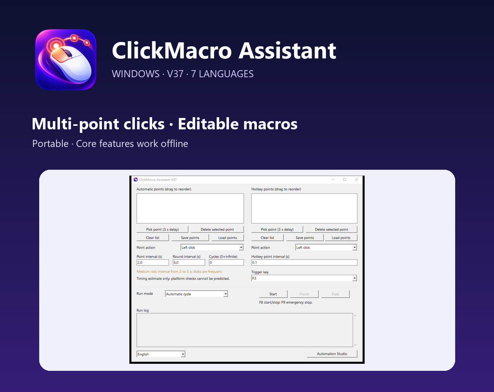
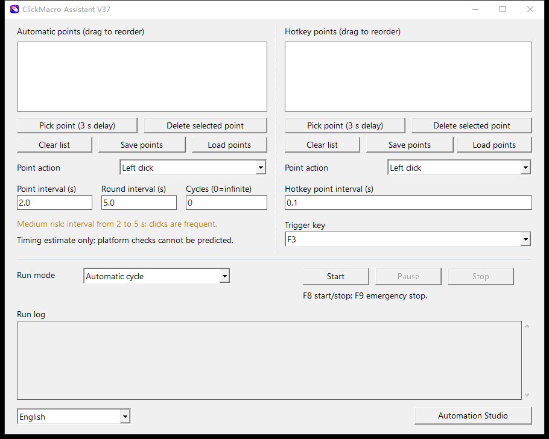
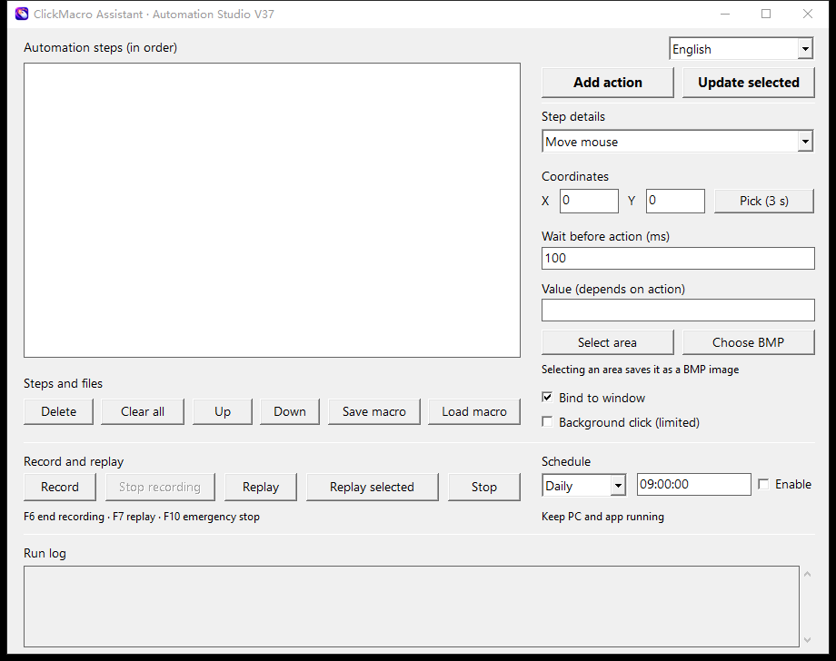

# ClickMacro Assistant

A portable Windows tool for multi-point clicking and editable mouse and keyboard macros. Arrange points for repeated actions, or record a desktop workflow and refine its steps in Automation Studio.

[View the Windows edition and purchase on itch.io](https://clickmacroassistant.itch.io/clickmacro-assistant) · [Quick start](docs/quick-start.md) · [FAQ](docs/faq.md)

## What it does

- **Multi-point clicking:** Build ordered lists of screen coordinates, drag to reorder them, and choose left click, right click, double click, or mouse move for each point.
- **Two point workflows:** Run automatic cycles with configurable timing, or trigger a separate one-pass point list using your chosen hotkey.
- **Automation Studio:** Record Windows-delivered mouse and keyboard events, edit or select steps, replay them, and save or load `.mcs` macros.
- **Additional tools:** Find and click a BMP image, schedule a run while the computer and app remain open, and inspect the run log.
- **Seven interface languages:** English, Simplified Chinese, Traditional Chinese, French, Russian, Spanish, and Arabic. English is the initial language.

## See the interface

| Multi-point clicker | Automation Studio |
| --- | --- |
|  |  |

## Download and setup

The Windows edition is sold and delivered on [itch.io](https://clickmacroassistant.itch.io/clickmacro-assistant). The download contains `ClickMacroAssistant.exe`, a quick start, and guides in seven languages. Extract the ZIP and run the EXE; no Python installation, account, or activation code is required. Point clicking, recording, and local macros work offline. Macro steps that open websites still require internet access.

The app does not request administrator rights automatically. Working with a protected or elevated window may require launching it as administrator. Windows may display a permission prompt when opening an elevated target program.

## Before recording a macro

Set up the target windows and files in the intended starting state. Replay depends on the starting screen, computer response speed, and target layout. Dynamic menus, rearranged files, protected applications, and changing window contents can cause a step to miss or stop. Practice with disposable files and do not record passwords or payment details. See the [quick start](docs/quick-start.md) and [FAQ](docs/faq.md) for specific guidance.

## Support and project information

For purchase and download help, use the itch.io product page. For product support, email **harsple2026@gmail.com** and include the app version, Windows version, and a description of the problem. Do not email passwords, payment details, or sensitive macro files.

This repository contains product information, screenshots, and public usage notes. The commercial Windows download is supplied through itch.io. No open-source license is granted by this repository. Some code, text, and visuals were created with generative AI assistance, as disclosed on the itch.io listing.